<p align="center">
  
</p>

<p align="center">
  
</p>

<p align="center">
  
  
  
</p>


### Boot sequence

```diff
@@ agentfabul.os — system check @@
+ [ OK ] role ............ Full-Stack Software Engineer
+ [ OK ] location ........ Philippines 🇵🇭
+ [ OK ] runtime ......... Node.js · TypeScript · React · PostgreSQL
+ [ OK ] focus ........... Business operations apps, billing & reporting automation, data tools
+ [ OK ] current task .... Building a scaffold-rental management platform
@@ directive: "If it's done in Excel twice, it should be an app." @@
```


### Installed modules

<table>
  <tr>
    <td width="120"><b>Core</b></td>
    <td></td>
  </tr>
  <tr>
    <td><b>Also runs</b></td>
    <td></td>
  </tr>
  <tr>
    <td><b>Toolchain</b></td>
    <td></td>
  </tr>
</table>


### Active builds

<table>
  <tr>
    <td width="50%" valign="top">
      <h4>🏗️ <a href="https://github.com/agentfabul/scaffolding-management-pro">Scaffolding Management Pro</a></h4>
      
      <p>End-to-end scaffold rental platform: inventory, tagging, deliveries and role-based encoding.</p>
      
      
      
    </td>
    <td width="50%" valign="top">
      <h4>📊 <a href="https://github.com/agentfabul/scaffold_report_tool">Scaffold Report Tool</a></h4>
      <p>Generates monthly billing summaries, tag summaries and dashboards from raw billing workbooks.</p>
      
      
    </td>
  </tr>
  <tr>
    <td width="50%" valign="top">
      <h4>🗺️ <a href="https://github.com/agentfabul/map">Interactive 3D Plot Plan</a></h4>
      <p>Turns a static PDF site plot plan into an interactive, explorable 3D map.</p>
      
      
    </td>
    <td width="50%" valign="top">
      <h4>⏱️ <a href="https://github.com/agentfabul/ojt-tracker">OJT Tracker</a></h4>
      <p>Internship monitoring and time-tracking system for trainees and supervisors.</p>
      
      
    </td>
  </tr>
  <tr>
    <td width="50%" valign="top">
      <h4>🤖 <a href="https://github.com/agentfabul/AutoQA">AutoQA</a></h4>
      <p>Automated QA tooling to speed up testing workflows.</p>
      
    </td>
    <td width="50%" valign="top">
      <h4>🧮 <a href="https://github.com/agentfabul/civil_calculator">Civil Calculator</a></h4>
      <p>Calculator for common civil-engineering computations.</p>
      
    </td>
  </tr>
</table>


### Diagnostics

<p align="center">
  
  
</p>

<p align="center">
  
</p>

<p align="center">
  
</p>


### Open a channel

<p align="center">
  <a href="https://github.com/agentfabul"></a>
</p>

<p align="center">
  
</p>
